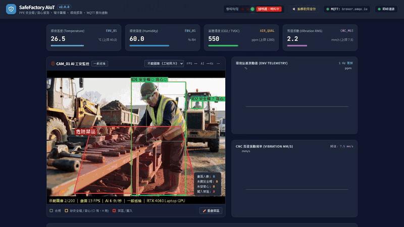
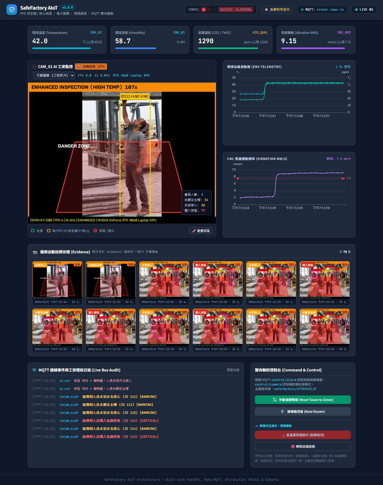
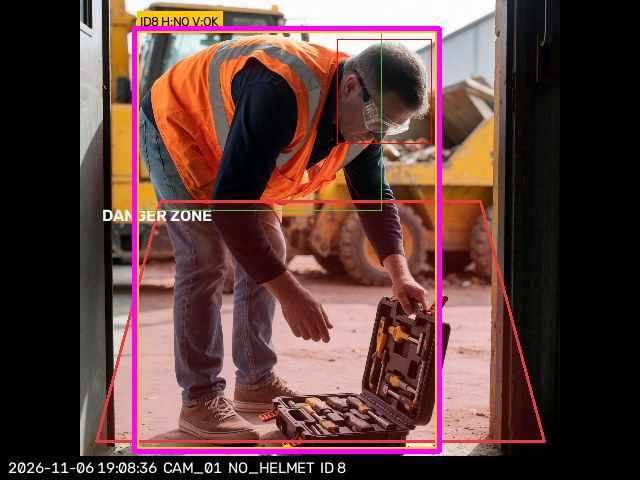
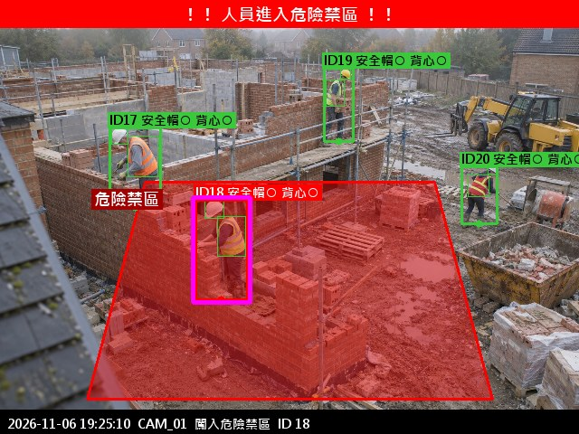
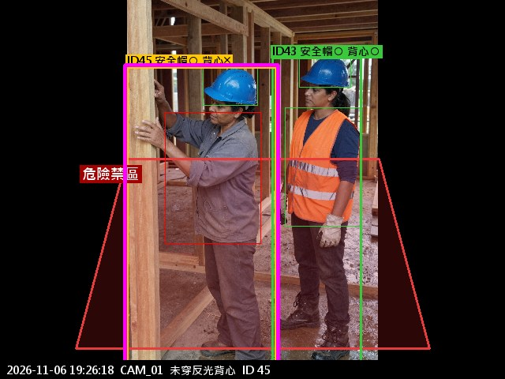

# SafeFactory AIoT — 智慧工廠 / 工地工安監控系統

[](https://www.python.org/)
[](https://fastapi.tiangolo.com/)
[](https://mqtt.org/)
[](https://github.com/ultralytics/ultralytics)

結合 **YOLO11 邊緣視覺**、**MQTT 發布/訂閱** 與 **環境感測** 的工安監控系統：

* 偵測人員**未戴安全帽 / 未穿反光背心**、**闖入危險區域**
* 監測環境**溫濕度、CO2 / TVOC 氣體、機台振動**
* **AI → IoT**：YOLO 確認違規 → MQTT 告警 → 警報塔燈 + 蜂鳴器 + 自動拍照存證
* **IoT → AI**：溫度過高 → MQTT 指令 → 攝影機進入「加強巡檢」模式
* **融合規則**：環境異常期間又有人闖入禁區 → 升級為 EMERGENCY

> 不需要任何外接硬體：攝影機用筆電鏡頭 / 影片檔 / 工地照片圖庫，ESP32 感測器與警報塔燈以程式模擬，且一樣透過 MQTT 收發指令，之後換成實體設備不必改架構。

## 展示影片



*2 倍速預覽：YOLO 偵測違規 → MQTT 告警與自動存證 → 溫度超標觸發加強巡檢 → 一鍵復歸。完整 70 秒版本（含中文字幕）：[docs/demo.mp4](docs/demo.mp4)*



*溫度升到 42°C 後的儀表板：警報塔燈轉紅、攝影機自動進入「加強巡檢」(橘框與倒數)，違規照片即時出現在存證區。*

---

## 偵測結果範例

| 未戴安全帽 | 闖入危險禁區 | 未穿反光背心 |
|---|---|---|
|  |  |  |
| 有穿背心，但沒戴安全帽 → `安全帽╳ 背心○` | 其他人在禁區外 (綠框)，ID18 腳踩進禁區 (紅框) | 左邊的人有安全帽、沒穿背心；右邊同事裝備齊全 |

標籤 `○` 代表有、`╳` 代表沒有、`？` 代表人太小看不清楚。框線顏色：**綠色** 合規、**黃色** 缺安全帽或背心、**紅色** 在禁區內、**粉紅色** 為本次觸發存證的人員。照片底部浮水印記錄時間、攝影機與違規類型。

> 畫面文字使用 Pillow + 微軟正黑體繪製 (OpenCV 原生不支援中文)，見 `backend/text_render.py`。

> 範例照片來自 [Ultralytics Construction-PPE 資料集](https://docs.ultralytics.com/datasets/detect/construction-ppe/) 的驗證集 (CC BY 4.0)，模型訓練時沒有看過這些照片。

---

## 系統架構

```text
 影像來源 (筆電鏡頭 / 影片 / 工地圖庫)
        │
        ▼
 YOLO11 人員偵測 + ByteTrack 追蹤 ─┐
 PPE 模型 (安全帽/背心)            ├─> 依位置配對 → 連續幀確認 → 拍照存證
 禁區多邊形 (腳底點判斷)           ─┘                     │
                                          vision/alerts (QoS 1)
                                                         ▼
 虛擬環境站 ──telemetry/env──>  [ MQTT Broker ]  <──── 規則引擎 (rule_engine.py)
 虛擬塔燈   <──control/alarm──        │                ├ 違規 → control/alarm
 攝影機     <──control/camera─        │                ├ 高溫 → control/camera
                                      ▼                └ 環境異常+闖入 → EMERGENCY
                          FastAPI (WebSocket / MJPEG / REST)
                                      ▼
                        Web 儀表板 (Tailwind + ECharts)
```

### MQTT 主題

主題根目錄為 `safefactory/<站台ID>`，站台 ID 第一次啟動時隨機產生並存在 `.site_id`，避免在公用 Broker 上和別人撞名。

| 主題 | QoS | 說明 |
|---|---|---|
| `…/telemetry/env` | 0 | 溫濕度、CO2、TVOC，每秒一筆 |
| `…/telemetry/machine` | 0 | 機台振動、轉速 |
| `…/vision/alerts` | 1 | 違規事件 (含存證照片網址，不傳圖片本體) |
| `…/control/alarm` | 1 | 塔燈 / 蜂鳴器指令：`SET` / `MUTE_BUZZER` / `RESET_ALARM` |
| `…/control/camera` | 1 | 攝影機指令：`ENHANCED_INSPECTION` |
| `…/status/devices` | 1 | 裝置上下線 (LWT + retained) |

連不上 Broker 時會自動改為本機派發，展示不會因為網路中斷而停擺。

---

## 重點設計

1. **PPE 判斷**：先用 COCO 模型偵測並追蹤「人」，再把 PPE 模型找到的安全帽框配對到人框上方 35% (頭部)、背心框配對到 15%–75% (軀幹)。比直接訓練 `no_helmet` 類別穩定，且每個人都有獨立判斷結果。
2. **禁區判斷**：用人框**底部中心點 (腳的位置)** 做 `cv2.pointPolygonTest`。禁區可以直接在儀表板上點選重畫，存在 `zone.json`。
3. **防誤報**：ByteTrack 追蹤 ID + 最近 12 幀中 8 幀違規才成立 + 同一人同一違規 30 秒冷卻。
4. **加強巡檢模式**：信心門檻 0.45→0.30、推論頻率加倍、確認視窗縮短、每 15 秒自動拍巡檢照，時間到自動恢復。
5. **感測器去雜訊**：連續 3 筆超標才觸發，溫度降到「上限 − 3°C」以下才解除 (遲滯)，避免門檻附近反覆觸發。
6. **存證**：違規照片存在 `evidence/日期/`，事件紀錄寫入 `evidence/events.jsonl`，重新啟動後仍可在儀表板查看。

---

## 專案結構

```text
auto-seen/
├── run.py                  # 啟動入口
├── test_demo.py            # 自動化連動測試腳本
├── requirements.txt
├── backend/
│   ├── config.py           # MQTT 主題、門檻值、視覺參數
│   ├── main.py             # FastAPI：REST / WebSocket / MJPEG 串流
│   ├── mqtt_manager.py     # MQTT 連線、LWT、離線備援
│   ├── rule_engine.py      # 連動規則 (AI→IoT、IoT→AI、融合)
│   ├── sensor_simulator.py # 虛擬環境站 + 虛擬警報塔燈
│   └── vision_worker.py    # YOLO 偵測、追蹤、PPE 配對、存證
├── frontend/index.html     # 儀表板
├── tools/train_ppe.py      # 訓練安全帽 / 背心模型
├── models/                 # 訓練好的 PPE 模型 (ppe_yolo11n.pt)
└── docs/images/            # README 用的截圖
```

執行時才會產生的資料夾 (不在版本控制內)：`evidence/` 存證照片、`datasets/` 訓練資料、`training/` 訓練紀錄、`videos/` 自己放的測試影片。

---

## 快速開始

### 0. 下載專案
```bash
git clone https://github.com/b3879121-rgb/auto-seen.git
cd auto-seen
```

### 1. 安裝套件
```bash
python -m venv .venv
.\.venv\Scripts\activate
pip install -r requirements.txt
# 有 NVIDIA 顯卡時改裝 GPU 版 PyTorch (速度約快 5–10 倍)
pip install --force-reinstall --no-deps torch torchvision --index-url https://download.pytorch.org/whl/cu132
```

### 2. 訓練安全帽 / 背心模型 (第一次需要)
```bash
python tools\train_ppe.py
```
會自動下載 Ultralytics Construction-PPE 資料集 (約 620MB，CC BY 4.0) 並訓練 YOLO11n，完成後輸出 `models/ppe_yolo11n.pt`。RTX 4060 約 20–30 分鐘。沒有這個檔案時系統仍可執行，只是只會偵測禁區。

> 倉庫內已附上訓練好的 `models/ppe_yolo11n.pt` (60 epochs)，clone 下來就能直接用，不必重新訓練。

驗證集 (200 張) 成績：

| 類別 | Precision | Recall | mAP50 |
|---|---|---|---|
| helmet 安全帽 | 0.93 | 0.78 | 0.86 |
| vest 反光背心 | 0.94 | 0.88 | 0.91 |
| Person 人員 | 0.95 | 0.90 | 0.94 |
| no_helmet | 0.80 | 0.58 | 0.64 |
| no_vest | 0.91 | 0.64 | 0.72 |
| 全部 12 類平均 | 0.87 | 0.71 | 0.77 |

「有戴」的類別比「沒戴」準很多，所以系統以「頭部區域找不到安全帽」為主要判斷依據，`no_helmet` 只當輔助。

### 3. 啟動
```bash
python run.py
```
開啟 `http://localhost:8000`。

### 4. 展示流程
* **影像來源**：右上角下拉選單切換「示範圖庫 / 筆電鏡頭 / videos 資料夾內的影片」。
* **PPE 違規**：示範圖庫會輪播模型沒看過的工地照片；用筆電鏡頭時，沒戴安全帽就會觸發黃燈與存證。
* **闖入禁區**：按「重畫禁區」，把禁區畫在畫面一側，走進去即觸發紅燈。
* **高溫連動**：按「注入感測異常」，3 秒後溫度連續超標 → 紅燈 + 攝影機進入加強巡檢 (畫面出現橘框與倒數)。
* **自動化腳本**：系統啟動後另開終端機執行 `python test_demo.py`，會自動跑完整個連動流程並印出結果。

### 環境變數

| 變數 | 預設 | 說明 |
|---|---|---|
| `MQTT_BROKER` | `broker.emqx.io` | 有安裝 Mosquitto 可設 `localhost` |
| `VIDEO_SOURCE` | `demo` | `demo` / `webcam` / `file:檔名.mp4` |
| `SITE_ID` | 隨機 | 指定 MQTT 主題的站台 ID |

---

## 注意事項

* 公用 Broker 任何人都能連線，正式環境請使用自架 Broker 並開啟帳號密碼、ACL 與 TLS。
* 存證照片含人臉，實際部署需訂定保存期限並遵守個資法。
* 本系統定位為**輔助監控**；實際的氣體偵測請使用經校正認證的偵測器，且不能取代實體安全連鎖裝置。
